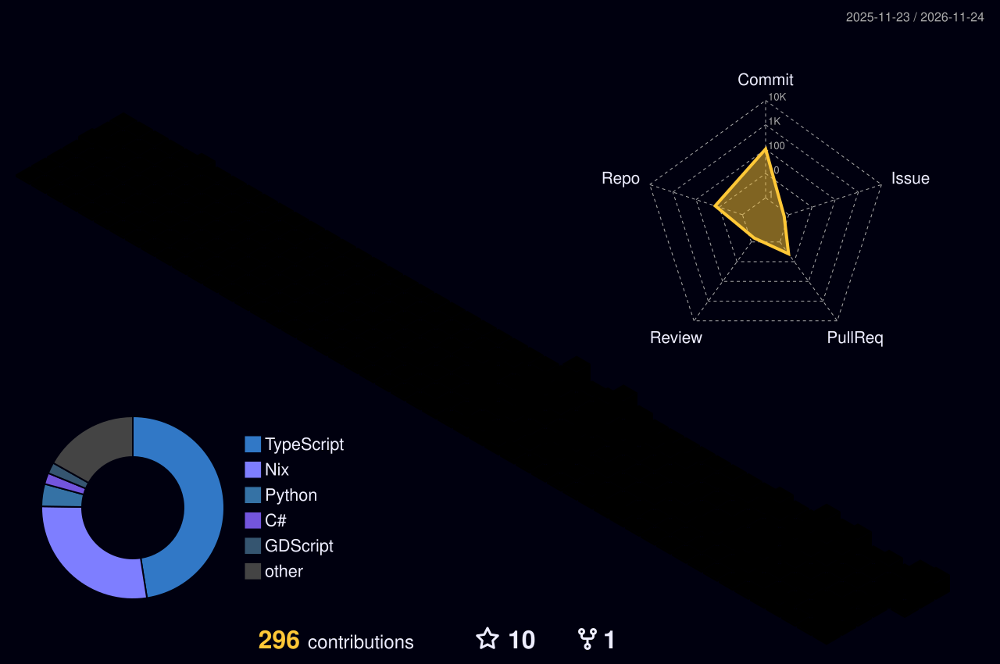

  

<h1 align="center">Hi 👋, I'm Anastasia</h1>
<h3 align="center">Software- and Game Developer</h3>

I'm a Hungarian software developer based in Budapest, currently studying Computer Engineering. I enjoy building practical applications, exploring new technologies, and understanding how software interacts with the systems and networks it runs on.  My interests span web development, desktop applications, backend engineering, Linux systems, and networking. I like solving real-world problems, improving existing projects, and learning through hands-on experience.  I am a motivated IT professional with qualifications in Software Development and Testing, as well as IT Systems and Application Operations. I have a strong interest in software engineering, IT infrastructure, and automation. I am currently pursuing a degree in Computer Engineering to further expand my technical knowledge and skills. I am eager to gain practical experience, develop professionally, and take on new challenges in the field of software development. I am currently open to junior software development opportunities.

   

### 🛠️ Tech Stack

                     

### 📊 GitHub Stats

### 🌎 3D Contribution Graph

